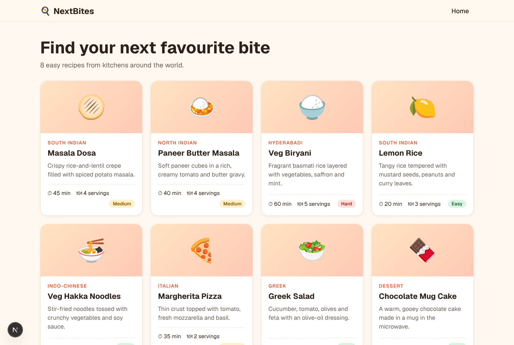
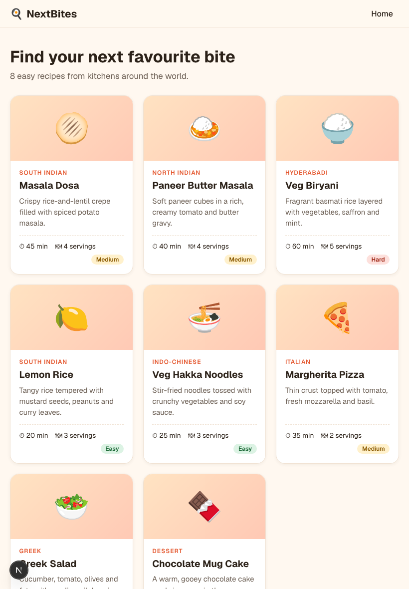
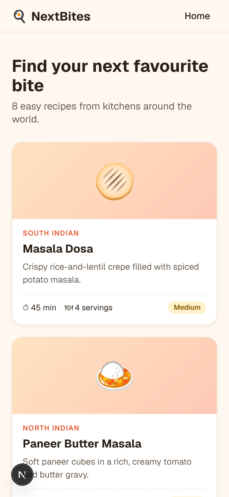

# NextBites 🍳

[](https://github.com/mugilstrange-ai/nextbites/actions/workflows/ci.yml)

A recipe website built with **Next.js (App Router)** and **TypeScript**.

## Part 1: home page

- `app/data/recipes.ts`: the `Recipe` type and the `recipes` array (single source of data)
- `app/components/RecipeCard.tsx`: one reusable card; its `recipe` prop is typed with `Recipe`
- `app/components/NavBar.tsx`: shared nav bar, rendered in `app/layout.tsx` so it shows on every page
- `app/page.tsx`: maps `recipes` into `<RecipeCard key={recipe.id} />` inside a responsive CSS grid
  (`repeat(auto-fill, minmax(230px, 1fr))`)

Coming next: search and recipe detail pages (Part 2) and a live deployment (Part 3).

## Run it locally

```bash
npm install
npm run dev
```

Then open http://localhost:3000.

## Proof that it builds and runs

Every pull request into `main` runs the [CI workflow](.github/workflows/ci.yml): `npm ci`, `npm run lint`,
`npm run build`, `npx tsc --noEmit`, then it starts the app and checks that the home page returns
200 with the nav bar and the recipe cards.

Screenshots of `npm run dev` at http://localhost:3000 (no error overlay; the grid reflows from
4 columns to 3 to 1):

| Desktop (1280px, 4 columns) | Tablet (820px, 3 columns) | Phone (390px, 1 column) |
| --- | --- | --- |
|  |  |  |
